  

  <a href="https://arunprakashg.com">Portfolio</a> &nbsp;✦&nbsp;
  <a href="https://www.linkedin.com/in/arunprakashg">LinkedIn</a> &nbsp;✦&nbsp;
  <a href="https://x.com/_arunprakash_">X</a> &nbsp;✦&nbsp;
  <a href="https://www.youtube.com/@arunprakashg">YouTube</a> &nbsp;✦&nbsp;
  <a href="mailto:hi@arunprakashg.com">Email</a>

Hey, I'm Arun. I've been writing code for about 8 years, from a Raspberry Pi assistant that told jokes in 2019 to a stickman brawler that runs in your browser in 2026. I'm based in Kerala, India.

I'll build most things at least once: Flutter apps, native iOS, backends, AI agents, Linux desktop tools. Lately that means a lot of Rust, a lot of Claude Code, and [Yozora](https://github.com/ArunPrakashG/yozora), my own take on a Hyprland desktop. I like pulling apart things that weren't meant to be pulled apart, like my motorcycle's Bluetooth stream. I also build my own PCs, and the one on my desk runs CachyOS.

Fun fact: my sister taught me Windows XP and Microsoft Paint, so she gets the credit. Still curious.

✦ **Building now:** [yozora](https://github.com/ArunPrakashG/yozora), an open-source Hyprland desktop in Rust and GPUI, and [reins](https://github.com/ArunPrakashG/reins), a harness for running Claude Code, Codex and Gemini CLIs side by side.

✦ **Recently launched:** [xposed](https://getxposed.link), [Impact Frame](https://impactframe.app) and [Twistgrip](https://twistgrip.arunprakashg.com).

✦ **Open source:** the [wave-planning](https://github.com/ArunPrakashG/wave-planning) Claude Code plugin, plus five Dart packages on pub.dev under the verified publisher [arunprakashg.com](https://pub.dev/publishers/arunprakashg.com/packages).

| Project | What it does | Built with |
| :-- | :-- | :-- |
| [**wave-planning**](https://github.com/ArunPrakashG/wave-planning) | Claude Code plugin that splits a project into dependency-ordered waves. Each phase runs in its own subagent and git worktree, on the cheapest model that can do the job. | Python · Claude Code |
| [**yozora**](https://github.com/ArunPrakashG/yozora) | Open-source desktop for Hyprland: bar, notifications, lock screen, idle, launcher and settings. | Rust · GPUI |
| [**reins**](https://github.com/ArunPrakashG/reins) | Hire, release and interrupt Claude Code, Codex and Gemini CLIs from one place, each in its own role and tmux session. | Rust |
| [**native-launcher**](https://github.com/ArunPrakashG/native-launcher) | Wayland app launcher with fuzzy search that learns your habits, plus plugins for windows, SSH, files and clipboard. Starts in under 35 ms. | Rust · GTK4 |
| [**wordpress_client**](https://github.com/ArunPrakashG/wordpress_client) | Typed WordPress REST API client for Dart and Flutter, with three auth methods, request middleware and caching. My most-starred project. | Dart · Flutter |
| [**xposed**](https://getxposed.link) | Right-click any file, get a public HTTPS link and a QR code. It streams from your disk, so nothing is uploaded, and the link expires in 24 hours. | Go · frp · SQLite |
| [**Impact Frame**](https://impactframe.app) | A stickman brawler in the browser. Fixed 120 Hz simulation, and the server replays every leaderboard run to check it. | WebGL2 · Rust (axum) |
| [**Twistgrip**](https://twistgrip.arunprakashg.com) | Companion app for the TVS Apache RTR 310, built on a Bluetooth stream I reverse-engineered. Live cockpit, ride replay, Wear OS watch face. | Kotlin · Wear OS · BLE |
| [**Nimbus**](https://usenimbus.dev) | WordPress plugin that moves a media library to S3, Cloudflare R2 or any S3-compatible storage without changing how you upload. | PHP · WordPress |
| [**system_mcp**](https://github.com/ArunPrakashG/system_mcp) | MCP server for Windows that gives agents cursor control, window management, UI automation and screenshots. | Python · MCP |

More Dart packages on pub.dev: [byte_converter](https://github.com/ArunPrakashG/byte_converter), [sonic](https://github.com/ArunPrakashG/sonic), [ever_cache](https://github.com/ArunPrakashG/ever_cache) and [temp_mail_gen](https://github.com/ArunPrakashG/temp_mail_gen).

<table>
  <tr>
    <td><b>Languages</b></td>
    <td>
      
      
      
      
      
      
      
      
    </td>
  </tr>
  <tr>
    <td><b>Apps &amp; web</b></td>
    <td>
      
      
      
      
      
      
    </td>
  </tr>
  <tr>
    <td><b>Backend &amp; cloud</b></td>
    <td>
      
      
      
      
      
      
      
      
      
      
      
    </td>
  </tr>
  <tr>
    <td><b>AI &amp; agents</b></td>
    <td>
      
      
      
      
      
      
    </td>
  </tr>
</table>

If you want to talk about AI agents, developer tools or architecture work, I'm easy to reach:
[arunprakashg.com](https://arunprakashg.com) &nbsp;✦&nbsp; [hi@arunprakashg.com](mailto:hi@arunprakashg.com) &nbsp;✦&nbsp; [LinkedIn](https://www.linkedin.com/in/arunprakashg) &nbsp;✦&nbsp; [X](https://x.com/_arunprakash_)

<i>"The cosmos is within us. We are made of star-stuff."</i> Carl Sagan

